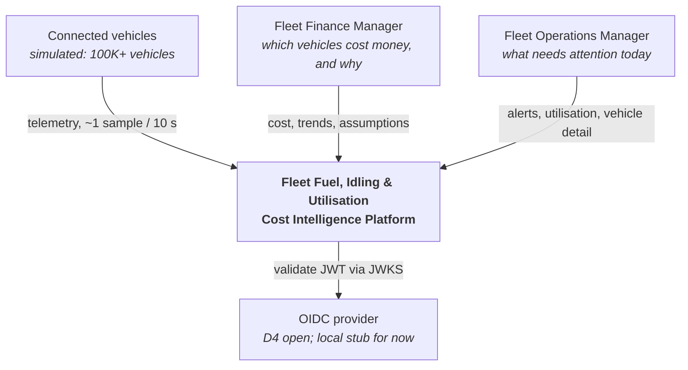
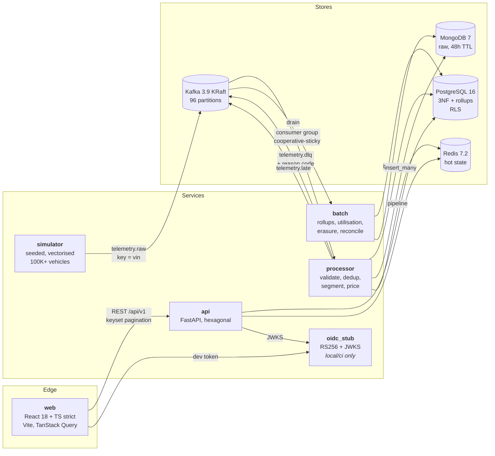
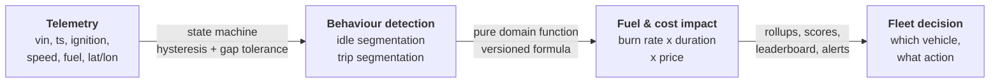
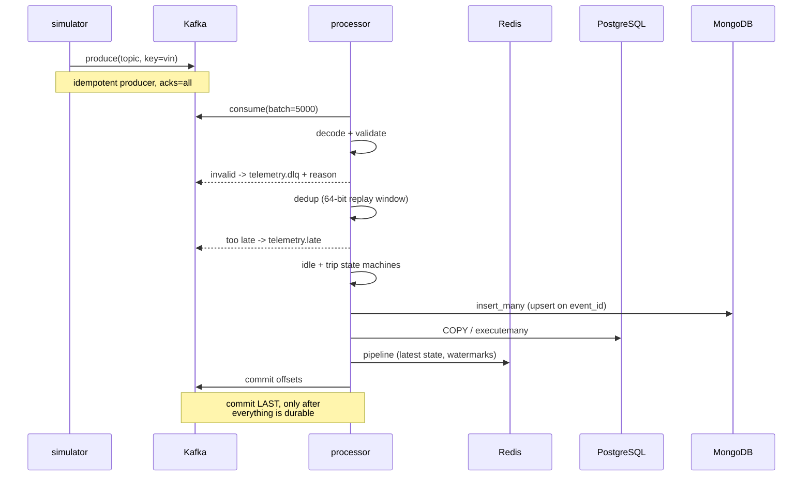
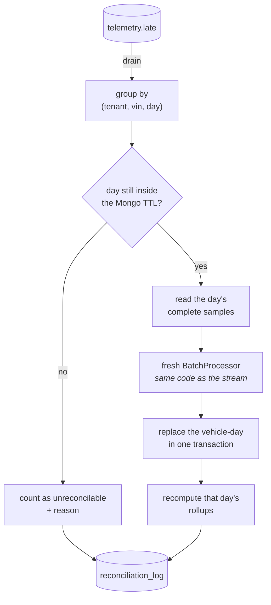
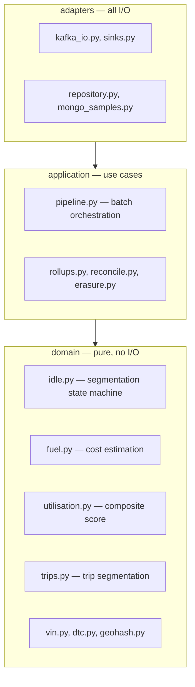
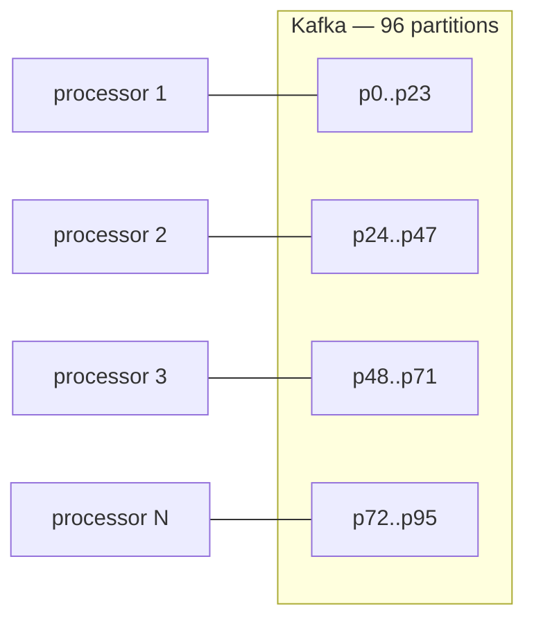
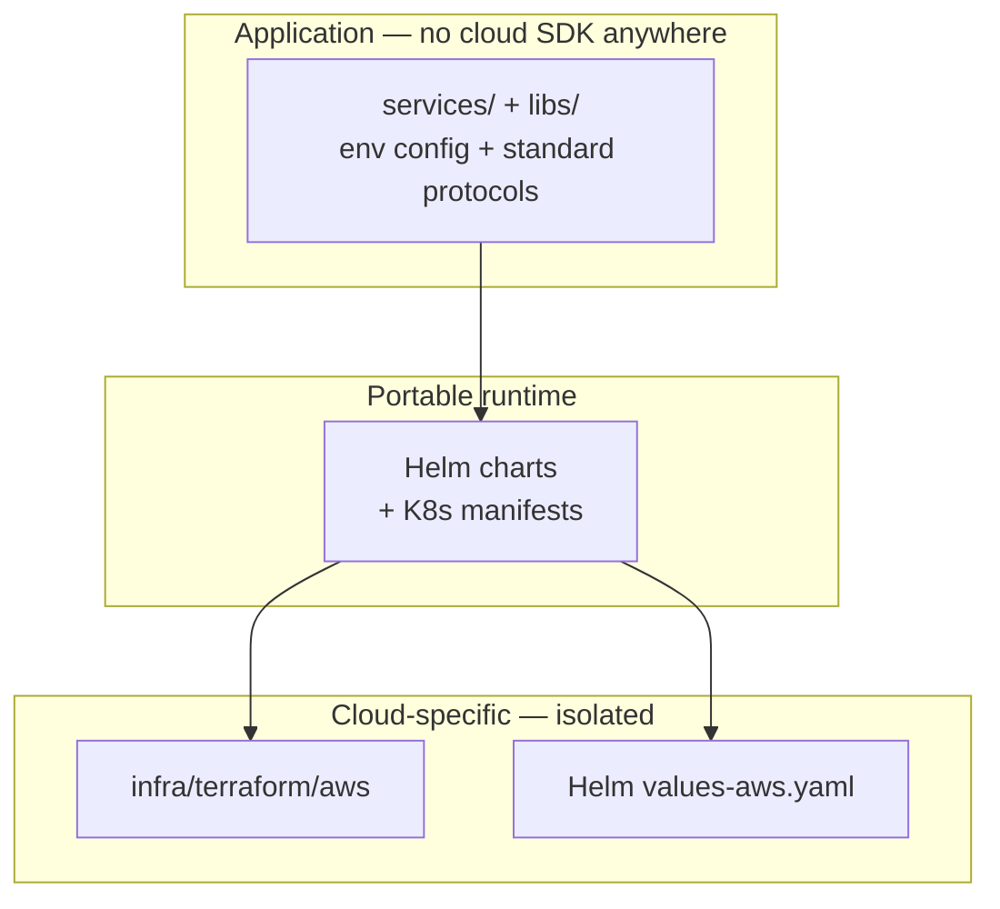

# Architecture

Mermaid rather than images, so the diagrams stay reviewable in a diff and cannot drift from
the code without someone editing them.

## C4 level 1 — context



No vendor appears in that diagram on purpose. The auth provider is D4 and remains open, so
the platform speaks generic OIDC and the provider is a configuration value (CLAUDE.md §3).

## C4 level 2 — containers



## The value chain

Every stage exists to turn the one before it into something a manager can act on.



## Request and event paths

### Ingest (hot path)



Offsets commit last. That ordering is the whole correctness argument: at-least-once delivery
plus idempotent writes gives an effectively-once outcome, whereas committing first would lose
a batch on any crash.

### Read (API)

```mermaid
sequenceDiagram
    participant W as web
    participant A as api
    participant R as Redis
    participant PG as PostgreSQL

    W->>A: GET /api/v1/... + Bearer
    A->>A: verify RS256 via JWKS,<br/>check iss/aud/exp, alg allow-list
    A->>R: rate-limit check
    A->>PG: SET ROLE fleet_app;<br/>set_config('app.tenant_id', ...)
    Note over A,PG: tenant from the TOKEN only,<br/>never the request
    A->>PG: keyset-paginated query
    A->>PG: INSERT audit_log
    A-->>W: JSON + assumptions + correlation id
```

### Reconciliation (ADR-0007)



The recomputation runs the **same** `BatchProcessor` the stream uses. A bespoke
re-segmentation path would be a second definition of an idle event, and two definitions
eventually disagree.

## Layering

Hexagonal, enforced by import direction rather than by convention alone:



Domain code imports no framework and no driver, which is why the algorithms are unit-testable
without infrastructure and why the property tests can run in milliseconds.

## Shared library

`libs/fleet_common` exists so there is one of each thing (CLAUDE.md §7): settings, structured
logging, error types and RFC 7807 responses, keyset pagination, JWT validation and RBAC,
event models generated against `schemas/`, VIN and DTC validators, geohash, and the domain
modules above. The simulator, processor, API, batch job and tests all import the same event
definition — a field name exists in exactly one place.

## Scaling model



Scaling is replicas and partitions, never a code change. 96 partitions comes from a
measurement, not a guess: 4,404 events/s per consumer means ~23 consumers for the 100K
events/s target, and 24 partitions left no headroom for a failure or a rolling deploy. At
100K vehicles the busiest partition carries 1.074x the mean (ADR-0004, ADR-0005).

## Cloud-agnostic boundary



Application code depends only on environment configuration and standard protocols — Kafka,
PostgreSQL, MongoDB, Redis, and an S3-compatible API behind an interface. Every AWS specific
lives in `infra/terraform/aws` and Helm values, so switching cloud means new IaC, not new
application code. Verified by the absence of any cloud SDK import in `services/` or `libs/`.

**The Terraform was never applied.** There is no AWS account for this project, and the
hackathon asks for IaC and an architecture deployable on a cloud, not a running cloud
environment. It is written, `validate`-clean and statically scanned; the Helm charts are
verified against a real Kubernetes cluster locally. That is stated plainly here and in the
solution document rather than implied otherwise.
