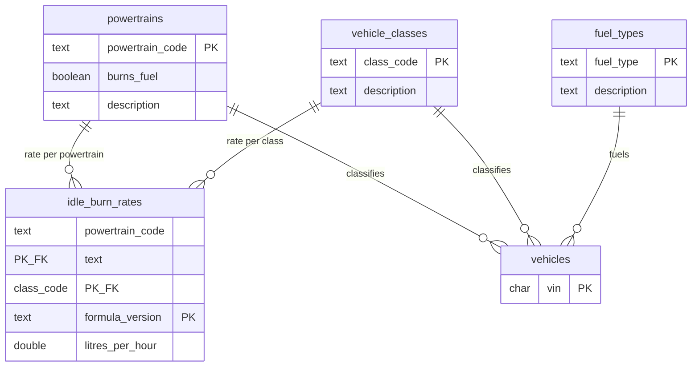
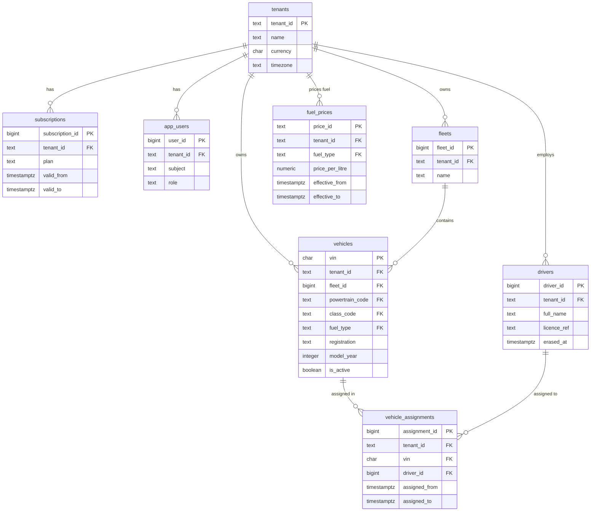
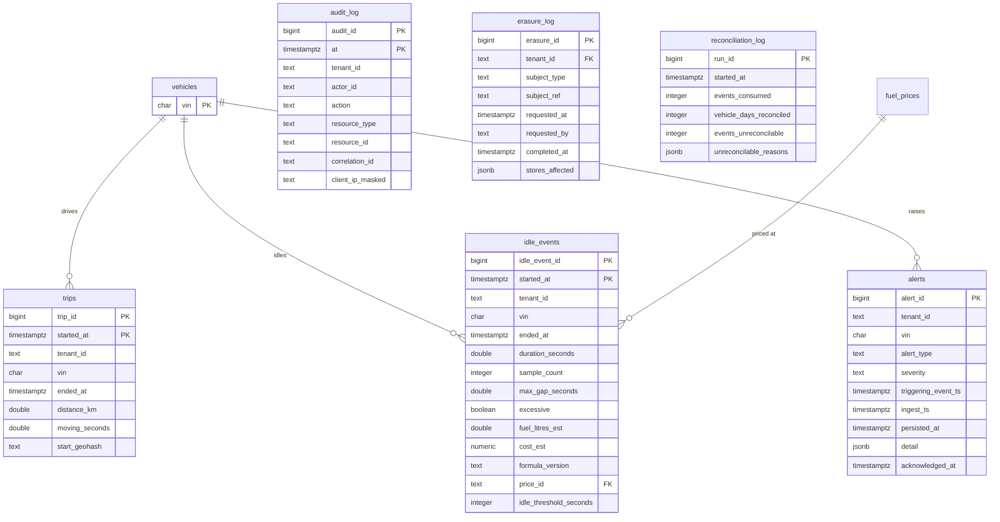
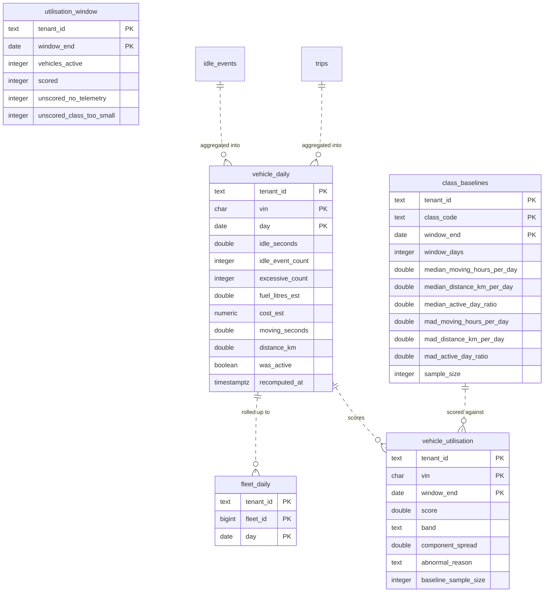

# ER diagram — PostgreSQL relational core

Generated from the migrations in `services/batch/batch/migrations/`, which are the source
of truth. Mermaid rather than an image so it stays reviewable in a diff.

The core is in **3NF**. Every deliberate denormalisation is a rollup table, and each is
labelled below with why it exists.

## Reference data (shared, not tenant-scoped)

`idle_burn_rates` is keyed on `(powertrain_code, class_code, formula_version)`. The
`formula_version` in the key is what makes a past cost figure reproducible: changing a burn
rate adds a row under a new version rather than overwriting the value a report was
calculated with.

## Tenant core

Three things here are load-bearing rather than incidental:

- **`vehicle_assignments` is a table, not a column on `vehicles`.** A driver-vehicle link is
  temporal: "who was driving this van on Tuesday" is a different question from "who drives it
  now". A `current_driver_id` column would destroy the history that answers the first, and
  that history is also personal data the erasure flow has to reach.
- **`fuel_prices` is temporal, keyed by `effective_from`/`effective_to`.** A cost computed
  last month must stay reproducible after a price change, so prices are appended and closed
  rather than updated (D11).
- **`drivers.erased_at`** exists because the right to erasure anonymises rather than deletes.
  The row survives so the operational record keeps its foreign keys; the identity does not
  (ADR-0007's sibling, migration 007).

## Time-series and derived data

`trips`, `idle_events` and `audit_log` are **range-partitioned by month** on their time
column, which is why each has a composite primary key including that column — PostgreSQL
requires the partition key in every unique index.

`alerts` is deliberately **not partitioned**. Its suppression guarantee needs a unique index
on `(vin, alert_type, idle_event_started_at)` alone, and adding a timestamp to satisfy the
partitioning rule would permit exactly the duplicate alerts the index exists to prevent.
Alerts are low volume — thousands per day against billions of telemetry rows — so losing
partition pruning costs little, while a database-enforced guarantee that an alert storm is
impossible is worth a great deal.

## Rollups — the deliberate denormalisations

| Rollup | Why it exists |
|---|---|
| `vehicle_daily` | One row per vehicle-day instead of one per idle event. The leaderboard reads this: measured, aggregating raw events over a 30-day window cannot meet p95 < 200 ms, and no index fixes a query that must read most of the table (`docs/evidence/sql/`). |
| `fleet_daily` | Derived from `vehicle_daily`, not from raw events — one derivation step, so the two can never disagree about the same day. |
| `vehicle_utilisation` | Scores are expensive (class baselines, median/MAD) and change daily, not per request. |
| `class_baselines` | Stored so a score is reproducible: you can see what it was compared against. |
| `utilisation_window` | Per-window accounting, with a CHECK that `scored + unscored_no_telemetry + unscored_class_too_small = vehicles_active`. Added because the API reported "0 vehicles unscored" while 1,808 were. |

Every rollup write is an **upsert keyed on the rollup key**, which is what makes re-running
a day correct rather than duplicating it — and therefore what makes late-event
reconciliation cheap (ADR-0007).

## MongoDB and Redis

Not in this diagram because neither is relational, but both are part of the data model:

| Store | Holds | Key |
|---|---|---|
| **MongoDB** `telemetry_raw` | Raw enriched telemetry, TTL on `ingest_ts` (48h default) | unique `event_id`; index `(vin, ts)` |
| **Redis** | Latest vehicle state, per-vehicle idle machine state, dedup replay window, API response cache, rate-limit counters | `vehicle:{vin}`, `wm:{vin}` |

The TTL is on **`ingest_ts`, not event time**, deliberately: a backdated event must not
expire the moment it is written. That choice is also what bounds late-event reconciliation
(ADR-0007).
